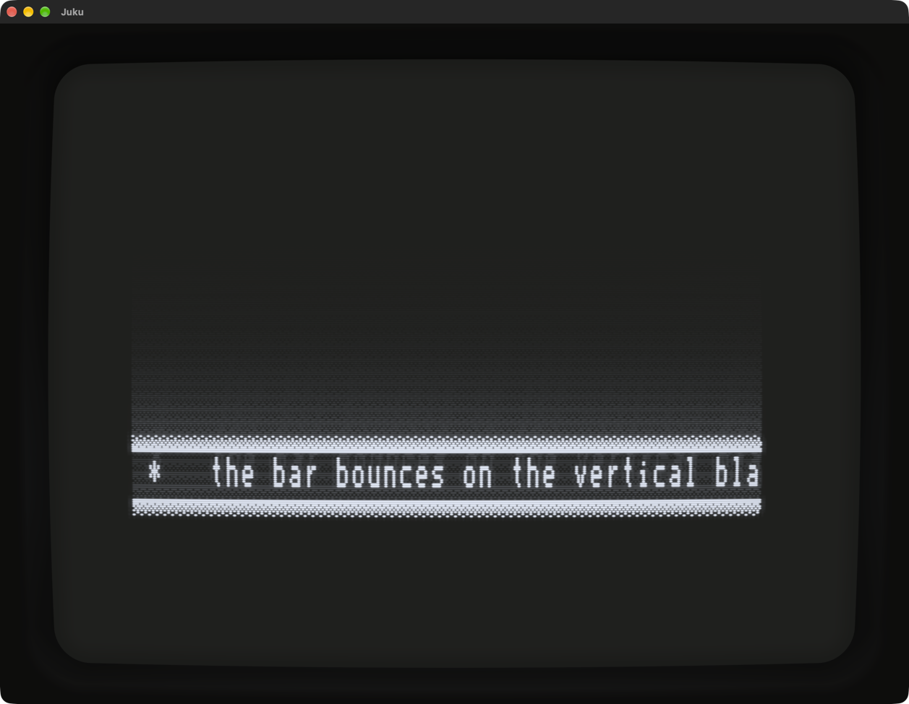

# Juku

An emulator of the Juku E5101/E5104, the Estonian school computer of the
late 1980s, for macOS and Windows. The Juku has an Intel 8080 class CPU,
RomBios in ROM and EKDOS, a CP/M compatible system, on 5.25" floppies.

## Features

- **The machine, cycle by cycle:** the 8080 with its instruction
  timings, the timers that make the picture and the sound, the interrupts,
  the floppy controller, the keyboard and the mouse, as closely as we have
  been able to work out from the ROMs, the disks, the documents and the
  schematics. Programs that time their tricks to the beam run. Not
  emulated: the cassette tape, the school network, the printer, and the
  extra memory and RAM disk cards.
- **A CRT on screen:** a picture modelled on a monitor of the time, with
  its curve, scanlines, glow and bezel, or plain pixels.
- **Two floppy drives**, with drive sounds: the motor, the head stepping
  and the door.
- **Snapshots** of the whole machine, disks and all, with a thumbnail of
  the screen in Finder and Explorer, and a quick save and load on a key.
- **The system ROMs included:** RomBios 3.43m, the default, and 3.43, and
  the older JMON 3.3 monitor with BASIC. A ROM file of your own, and
  expansion ROMs such as JBASIC, can be plugged in.
- **The Juku's keyboard on yours**, by key position, with the Estonian
  letters, and the Juku's mouse.
- **A debugger for Juku programs** on the Mac, in VS Code (see
  [Development](docs/Development.md#debugging-juku-programs)).
- **English and Estonian.**

| | |
|---|---|
|  |  |

## Installation

Download the latest release from the
[Releases](https://github.com/sinijarv-juku/juku-emu/releases) page.

- **macOS 14 or later**, Apple silicon: open `Juku-<version>.dmg` and drag
  Juku to Applications.
- **Windows 10 or 11**, x64: run `Juku-<version>-windows-x64-setup.exe`,
  or unpack the `.zip` anywhere and run `Juku.exe`. The installer makes
  Juku open `.juk` disk images and `.jukusnap` snapshots; with the zip,
  Settings has a button for that. The Windows downloads are not signed
  yet, so Windows may warn that it does not know the publisher: choose
  More info, then Run anyway.

Disk images are not included. The
[juku3000](https://github.com/infoaed/juku3000) project, which keeps the
Juku usable, collects them, and its software catalogue tells where to
download them. Juku reads `.juk` images, and raw sector images as `.img`,
`.dsk` or `.cpm`. juku3000 also has the ROMs, among them the JBASIC 1.1
expansion ROM, which is not included here.

## Using Juku

Juku starts with the machine switched on: RomBios greets you and waits at
its `*` prompt, where a letter is a monitor command.

**Booting EKDOS.** Put a system disk in drive A: (Disks → A: → Insert…, or
drag the image onto the window), then type `T` (boot), `D` (from disk) and
`D` (double-sided). EKDOS starts at `A>`.

**Disks.** A disk you put in is read into memory, and what programs write
goes there, not to its file. Disks → Save Disk… writes it to a file; Juku
asks before a changed disk would be lost. New Disk gives a formatted, empty
one. Write Protect keeps programs from writing to a disk. Holding Option
(Mac) or Alt (Windows) as you drop an image puts it in B:.

**Keyboard.** Keys go to the Juku by position, so the Juku's layout is on
your keyboard's keys: Ü, Õ, Ö and Ä are where `[`, `]`, `;` and `'` are.
Input → Keyboard Mapping lists every key whose Juku legend differs. Caps
Lock follows yours.

**Mouse.** A click captures the mouse when the running program uses it;
Capture Mouse in the Input menu does it any time, and lets it go again.

**Shortcuts.** On Windows, Left Alt does what ⌘ does on the Mac.

| | Mac | Windows |
|---|---|---|
| Reset (the reset button) | ⌘R | Alt+R |
| Power cycle | ⇧⌘R | Alt+Shift+R |
| Insert a disk in A: / B: | ⌘1 / ⌘2 | Alt+1 / Alt+2 |
| Eject A: / B: | ⇧⌘1 / ⇧⌘2 | Alt+Shift+1 / Alt+Shift+2 |
| Quick save / quick load | ⌘S / ⌘L | Alt+S / Alt+L |
| Save snapshot / open snapshot | ⇧⌘S / ⌘O | Alt+Shift+S / Alt+O |
| Pause | ⌘P | Alt+P |
| Warp speed (up to 20×, muted) | ⌘W | Alt+W |
| CRT effects on and off | ⌘E | Alt+E |
| Capture and release the mouse | ⌘M | Alt+M |
| Full screen | ⌃⌘F | Alt+Enter |
| Settings | ⌘, | Alt+, |

**Expansion ROMs.** Machine → Expansion ROM → Other… plugs in a ROM file,
such as JBASIC; type `A` at the `*` prompt to start it.

**Settings** has three panes. General: the mouse speed, the sounds (the
key click, the drive sounds and their volume), the language and, on
Windows, light or dark mode. Display: the CRT effects and the picture's
look. Machine: the system ROM, the expansion ROM, the speed of the timer
some programs need (RDEM, for one) and, on the Mac, the debugger.

## More

- [Development](docs/Development.md): building Juku, its tests, and
  debugging Juku programs in VS Code.
- [The Juku](docs/Juku_machine_description.md): our best understanding
  of how the real machine works, its memory and ports, devices, keyboard,
  video and RomBios, and where each piece of it comes from.
- [The emulator's design](docs/Emulator_spec.md): how it is built, and the
  decisions taken.
- [juku3000](https://github.com/infoaed/juku3000) (in Estonian): the
  Juku's history and documents, its operating system EKDOS, disk images,
  ROMs and a catalogue of the software recovered from old disks, tapes and
  ROMs.
- [juku-sdk](https://github.com/sinijarv-juku/juku-sdk): the assembler, a
  disk image tool and the VS Code extension, for writing Juku programs.

## License

MIT, see [LICENSE](LICENSE). The ROM images in `resources/roms` are not
covered by it; their [README](resources/roms/README.md) says where they
come from and why they are included.
