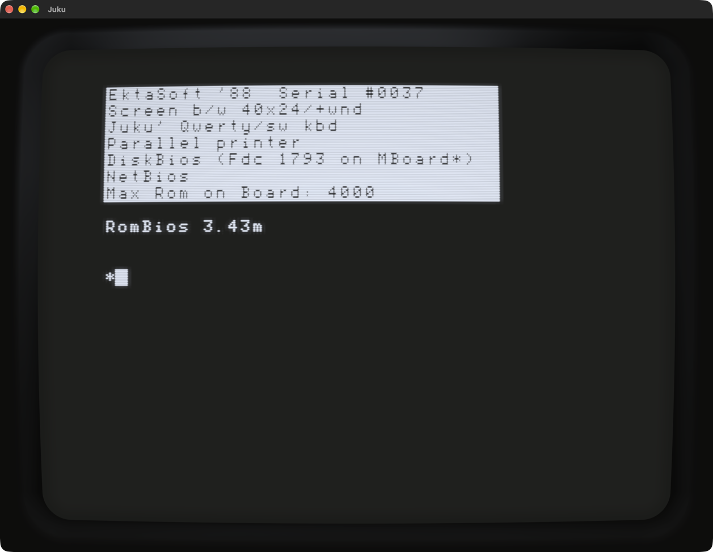
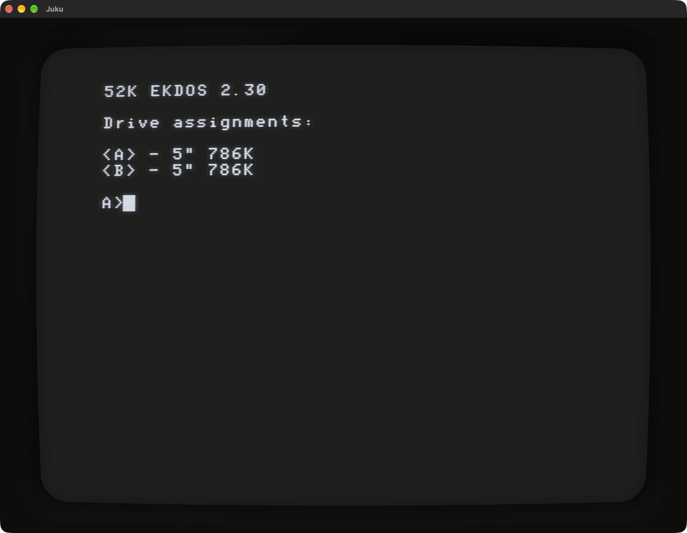

# Juku

An emulator of the Juku E5101/E5104, the Estonian school computer of the
late 1980s, for macOS and Windows. The Juku has an Intel 8080 class CPU,
RomBios in ROM and EKDOS, a CP/M compatible system, on 5.25" floppies.

## Features

- **Hardware emulation:** the 8080 CPU with its instruction timings, the
  timers that generate the video and sound, the interrupt controller, the
  floppy disk controller, the keyboard and the mouse. The behavior is
  derived from the ROMs, disk images, documentation and schematics.
  Programs that synchronize with the video beam should run correctly.
  Not emulated: the cassette interface, the school network, the printer,
  and the memory expansion and RAM disk cards.
- **Display:** a simulated CRT monitor with screen curvature, scanlines,
  phosphor glow and a bezel, or unfiltered pixels.
- **Floppy drives:** two drives, with optional sounds for the motor, head
  stepping and door.
- **Snapshots:** the complete machine state, including the disks, saved
  to a file. Finder and Explorer show a thumbnail of the screen. Quick
  save and quick load have keyboard shortcuts, and Save Quick Save As…
  keeps a quick save as a snapshot file of its own.
- **ROMs:** RomBios 3.43m (the default) and 3.43, and the earlier JMON 3.3
  monitor with BASIC, are included. Other system ROM files and expansion
  ROMs, such as JBASIC, can be loaded.
- **Input:** the Juku keyboard layout mapped by key position, including
  the Estonian letters, and the Juku mouse. A window shows the Juku
  keyboard, with the keys to press on yours and the keys that are down;
  its keys can be clicked.
- **Debugger:** debugging of Juku programs in VS Code (see
  [Development](docs/Development.md#debugging-juku-programs)).
- **Languages:** English and Estonian user interface.

| | |
|---|---|
|  |  |

## Installation

Download the latest release from the
[Releases](https://github.com/sinijarv-juku/juku-emu/releases) page.

- **macOS 14 or later:** open `Juku-<version>-macos-arm64.dmg` on a Mac
  with Apple silicon, or `Juku-<version>-macos-x64.dmg` on one with an
  Intel processor, and drag Juku to Applications. To see which you have,
  choose Apple menu → About This Mac: it names the chip or the processor.
  The Intel version has not been tried on an Intel Mac yet; if it does not
  work there, please report it on the
  [Issues](https://github.com/sinijarv-juku/juku-emu/issues) page.
- **Windows 10 or 11**, x64: run `Juku-<version>-windows-x64-setup.exe`,
  or unpack the `.zip` anywhere and run `Juku.exe`. The installer makes
  Juku open `.juk` disk images and `.jukusnap` snapshots; with the zip,
  Settings has a button for that. The Windows downloads are not signed
  yet, so Windows may warn that it does not know the publisher: choose
  More info, then Run anyway.

Disk images are not included. The
[juku3000](https://github.com/infoaed/juku3000) project, which preserves
the Juku's software and documents, collects them, and its software catalog
lists where to download them. Juku reads `.juk` images, and raw sector images as `.img`,
`.dsk` or `.cpm`. juku3000 also has the ROMs, among them the JBASIC 1.1
expansion ROM, which is not included here.

## Using Juku

Juku starts with the machine switched on: RomBios prints its banner and waits
at its `*` prompt, where a letter is a monitor command.

**Booting EKDOS.** Put a system disk in drive A: (Disks → A: → Insert…, or
drag the image onto the window), then type `T` (boot), `D` (from disk) and
`D` (double-sided). EKDOS starts at `A>`.

**Disks.** A disk you put in is read into memory, and what programs write
goes there, not to its file. Disks → Save Disk… writes it to a file; Juku
asks before a changed disk would be lost. New Disk gives a formatted, empty
one. Write Protect keeps programs from writing to a disk. Holding Option
(Mac) or Alt (Windows) as you drop an image puts it in B:.

**Keyboard.** Keys go to the Juku by position, so the Juku's layout is on
your keyboard's keys: Ü, Õ, Ö and Ä are where `[`, `]`, `;` and `'` are
on a US keyboard. Caps Lock follows yours.

Input → Keyboard (⌘K on the Mac, Alt+K on Windows) shows the Juku
keyboard. A blue tag on a key names the key to press for it on yours where
that is not the key its legend suggests, in your keyboard layout; Mac
Keys (PC Keys on Windows) shows the tags on every key, or on none. Keys go
down as you type, and a click presses a key: hold the mouse button to hold
it, and a click on SHIFT or CTRL keeps it down until the next key.
Pointing at a key shows your keys for it below. LAT, RUS and CAPS show the
RomBios keyboard mode. The window stays above the emulator without taking
the keyboard from it, so typing goes on while it is open.

**Mouse.** A click captures the mouse when the running program uses it;
Capture Mouse in the Input menu does it any time, and lets it go again.

**Shortcuts.** On Windows, Left Alt does what ⌘ does on the Mac.

| | Mac | Windows |
|---|---|---|
| Reset (the reset button) | ⌘R | Alt+R |
| Power cycle | ⇧⌘R | Alt+Shift+R |
| Insert a disk in A: / B: | ⌘1 / ⌘2 | Alt+1 / Alt+2 |
| Eject A: / B: | ⇧⌘1 / ⇧⌘2 | Alt+Shift+1 / Alt+Shift+2 |
| Quick save / quick load | ⌘S / ⌘L | Alt+S / Alt+L |
| Save snapshot / open snapshot | ⇧⌘S / ⌘O | Alt+Shift+S / Alt+O |
| Pause | ⌘P | Alt+P |
| Warp speed (up to 20×, muted) | ⌘W | Alt+W |
| CRT effects on and off | ⌘E | Alt+E |
| Capture and release the mouse | ⌘M | Alt+M |
| Show and hide the keyboard | ⌘K | Alt+K |
| Full screen | ⌃⌘F | Alt+Enter |
| Settings | ⌘, | Alt+, |

**Expansion ROMs.** Machine → Expansion ROM → Other… plugs in a ROM file,
such as JBASIC; type `A` at the `*` prompt to start it.

**Settings** has four panes. General: the mouse speed, the language and,
on Windows, light or dark mode. Display: the CRT effects and the
picture's look. Sound: the key click, the drive sounds, their volume and
how far apart the two drives are heard. Machine: the system ROM, the
expansion ROM, the speed of the timer some programs need (RDEM, for one)
and the debugger.

## More

- [Development](docs/Development.md): building Juku, its tests, and
  debugging Juku programs in VS Code.
- [The Juku](docs/Juku_machine_description.md): our best understanding
  of how the real machine works, its memory and ports, devices, keyboard,
  video and RomBios, and where each piece of it comes from.
- [The emulator's design](docs/Emulator_spec.md): how it is built, and the
  decisions taken.
- [juku3000](https://github.com/infoaed/juku3000) (in Estonian): the
  Juku's history and documents, its operating system EKDOS, disk images,
  ROMs and a catalog of the software recovered from old disks, tapes and
  ROMs.
- [juku-sdk](https://github.com/sinijarv-juku/juku-sdk): the assembler, a
  disk image tool and the VS Code extension, for writing Juku programs.

## License

MIT, see [LICENSE](LICENSE). The ROM images in `resources/roms` are not
covered by it; their [README](resources/roms/README.md) says where they
come from and why they are included. The keyboard window's lettering is
made from Sofia Sans, under the SIL Open Font License
([core/src/keyboard/Sofia-Sans-OFL.txt](core/src/keyboard/Sofia-Sans-OFL.txt)).
